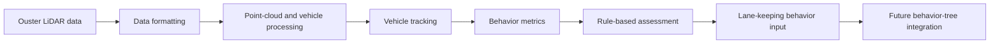
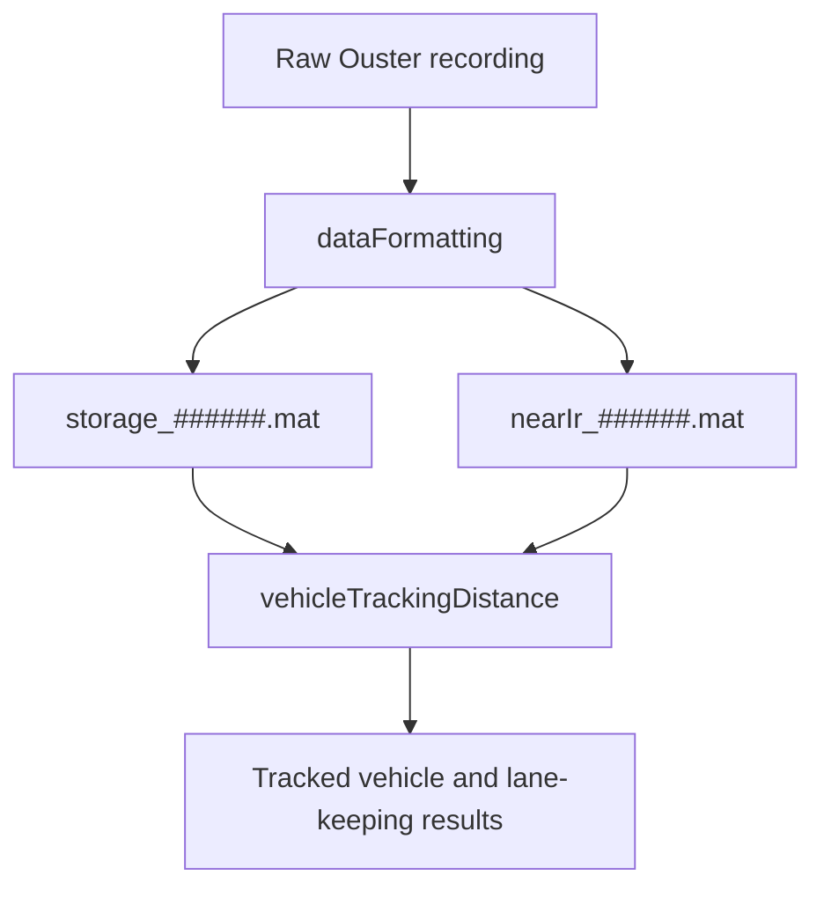

# LiDAR Lane-Keeping Assistance System

Research code accompanying the SAE technical paper **“Development of a Rule-Based Lidar Lane-Keeping Assistance System for Autonomous Vehicles Applications”** (SAE 2025-01-8025).

This repository contains MATLAB-based tools for processing Ouster LiDAR data, detecting and tracking vehicles, and evaluating interpretable lane-keeping behavior metrics. The work is intended for research, reproducibility, and continued development—not as a production-ready autonomous-driving system.

## Research overview

The system investigates a rule-based LiDAR module that evaluates the lane-keeping behavior of an oncoming vehicle on a two-way, two-lane road without a physical barrier. The module is designed as one component of a larger behavior-tree architecture for adaptive lane-keeping assistance.

The analysis combines LiDAR-based vehicle tracking with interpretable metrics such as:

- Distance to Lane Marking (DTLM)
- Trajectory prediction error (pE)
- Relative distance between the ego and target vehicles
- Predicted crossings of the dividing lane
- Number of tracked vehicle points (NoP)



## Repository workflow

The primary MATLAB workflow is:



## Requirements

- MATLAB with the required LiDAR and point-cloud functionality for the scripts in this repository
- Python 3 and pip, if using the repository's Python dependencies
- An Ouster LiDAR recording or the generated `storage_######.mat` and `nearIr_######.mat` files
- Optional hardware workflow: an NVIDIA Jetson connected to an Ouster LiDAR sensor

Install the Python dependencies with:

```bash
pip3 install -r requirements.txt
```

> The repository no longer uses Git Large File Storage. Large data files are not included in this README or assumed to be available in the public repository.

## Running the vehicle-tracking workflow

### 1. Format the data

Skip this step if the required `storage_######.mat` and `nearIr_######.mat` files already exist.

1. Open `dataFormatting` in MATLAB.
2. Configure the `ousterFileReader` input for the desired recording.
3. Update the output section so that the `nearIr` and `storage` variables are saved using the intended filenames.
4. Run the script.

### 2. Run vehicle tracking

1. Open `vehicleTrackingDistance.m`.
2. Review the instructions at the top of the file.
3. Clear the MATLAB workspace before switching to a different scene.
4. Load the scene-specific data, if required.
5. Run the script to perform vehicle tracking and calculate the relevant distance and behavior measurements.

## Ouster LiDAR and NVIDIA Jetson

For live sensor operation, install the [Ouster Sensor SDK](https://static.ouster.dev/sdk-docs/index.html) on the NVIDIA Jetson.

A typical connection workflow is:

1. Connect the Ouster LiDAR to the Jetson over Ethernet.
2. Confirm the network connection in the Jetson network settings.
3. Use `ip addr show` to inspect the Ethernet interface, if needed.
4. Run `ouster-cli discover` to identify the connected sensor and verify communication.
5. Start visualization with the discovered hostname, for example:

```bash
ouster-cli source os-<sensor-id>.local viz
```

Replace `<sensor-id>` with the identifier reported by `ouster-cli discover`. Sensor identifiers and network configuration are installation-specific and should not be assumed from example values.

## Project contributions

The repository supports the work reported in the SAE paper. Based on the project contribution history provided by the authors:

- **Luke Kroeger** — primary implementation and development of the vehicle-tracking and lane-keeping analysis workflow.
- **Robin Lange** — literature review, code coordination and collaboration, and preparation of figures.
- **Valentin Soloiu** — research supervision and project contribution.
- **Shaen Mehrzed** — research contribution.
- **Kody Pierce** — research contribution.
- **Timothy Sutton** — research contribution.

Please refer to the paper for the formal author list, affiliations, and publication record.

## Publication

> Soloiu, V., Mehrzed, S., Kroeger, L., Pierce, K., Sutton, T., and Lange, R. “Development of a Rule-Based Lidar Lane-Keeping Assistance System for Autonomous Vehicles Applications.” *WCX SAE World Congress Experience*, SAE Technical Paper 2025-01-8025, April 1, 2025.

- [SAE Mobilus paper page](https://saemobilus.sae.org/papers/development-a-rule-based-lidar-lane-keeping-assistance-system-autonomous-vehicles-applications-2025-01-8025)
- [DOI: 10.4271/2025-01-8025](https://doi.org/10.4271/2025-01-8025)

If you use this repository or build on the implementation, please cite the paper and acknowledge the contributors listed above.

## Related resources

### LiDAR lane detection and MATLAB

- [Lane detection in 3-D LiDAR point clouds](https://www.mathworks.com/help/lidar/ug/lane-detection-in-3d-lidar-point-cloud.html)
- [Lane detection in LiDAR data using deep learning](https://www.mathworks.com/help/driving/ug/lane-detection-in-lidar-data-using-deep-learning.html)
- [Getting started with LiDAR lane detection using deep learning](https://www.mathworks.com/help/driving/ug/get-started-with-lidar-lane-detection-using-deep-learning.html)
- [`lidarlanedetector.detect`](https://www.mathworks.com/help/driving/ref/lidarlanedetector.detect.html)
- [`trainLidarLaneDetector`](https://www.mathworks.com/help/driving/ref/trainlidarlanedetector.html)

### Behavior-tree planning

- [Autoware Behavior Path Planner](https://autowarefoundation.github.io/autoware.universe/pr-2609/planning/behavior_path_planner/)
- [py-trees documentation](https://py-trees.readthedocs.io/en/devel/)
- [PlantText UML editor](https://www.planttext.com/)

### Background literature and datasets

- [IEEE reference](https://ieeexplore.ieee.org/document/9827157)
- [LUMPI dataset](https://data.uni-hannover.de/cs_CZ/dataset/lumpi)
- [CARISSMA research on safer intersections](https://www.thi.de/forschung/carissma/aktuelles-presse/einzelansicht/news/kuenstliche-intelligenz-soll-kreuzungen-in-ingolstadt-sicherer-machen/)
- [TUM research document](https://mediatum.ub.tum.de/doc/1145103/file.pdf)
- [Fraunhofer research on AI-controlled traffic lights](https://www.fraunhofer.de/de/presse/presseinformationen/2022/februar-2022/kuenstliche-intelligenz-steuert-ampelanlagen.html)
- [DIVA research document](https://www.diva-portal.org/smash/get/diva2:907048/FULLTEXT01.pdf)

## Scope and limitations

This repository is a research prototype. Results depend on the available LiDAR recordings, sensor calibration, road geometry, scene selection, and MATLAB environment. The implementation should not be used to control a vehicle or make safety-critical decisions without independent validation, testing, and appropriate safety engineering.
